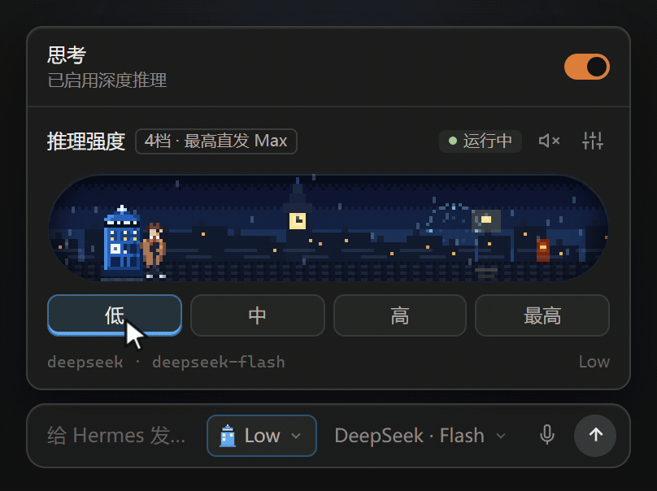
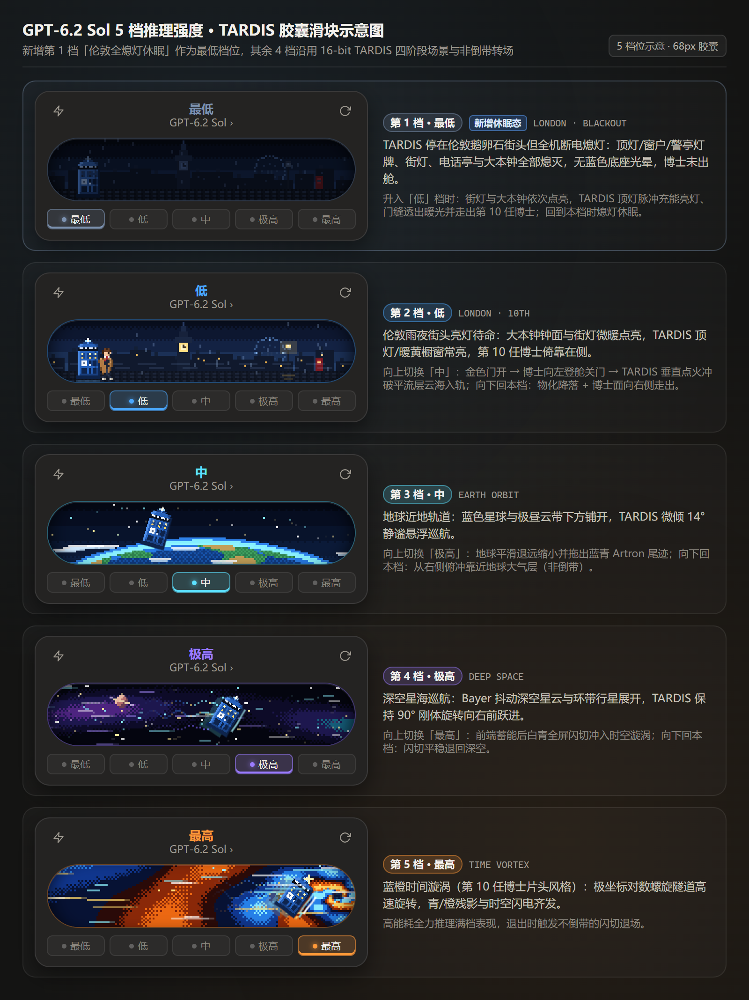

# TARDIS Thinking Effort Kit

> **16-bit *Doctor Who* TARDIS pixel-art reasoning-effort slider plugins, client extensions, and Canvas2D animation engine.**

[English](#english) | [简体中文](#简体中文)

<p align="center">
  
</p>

<p align="center">
  
</p>

---

## English

### Overview

**TARDIS Thinking Effort Kit** turns the plain AI reasoning-effort selector into an interactive **16-bit *Doctor Who* TARDIS pixel-art flight capsule**. Instead of a dull dropdown or plain bar, adjusting your model's reasoning effort sends the TARDIS across an atmospheric pixel journey:

| Visual Stage | Scene | Description |
| --- | --- | --- |
| **0 — London Lights Off** | Quiet London Night | TARDIS parked in drizzle with all exterior lights turned off (`codex-animation` 5-stage edition, static frame with sequential light-off/light-on transitions to/from London Standby) |
| **1 — London Standby** | 10th Doctor in London | Rainy London cobblestone street with warm lantern glow and the 10th Doctor leaning beside the glowing police box |
| **2 — Earth Orbit** | Low-Earth Orbit | Weightless hover above the sunlit blue planet and atmospheric rim |
| **3 — Deep Space** | Deep-Space Cruise | Crisp 90-degree rigid rotation and warp streaks across deep-space starfields |
| **4 — Time Vortex** | 10th Doctor Vortex | Blue-and-orange Time Vortex turbulence with lightning flashes and pixel afterimages |

Highlights:
- **Forward & Return Cinema Transitions**: Lowering effort plays dedicated return-to-orbit / rain-night materialization transitions rather than clumsily rewinding frames.
- **Zero Idle Overhead**: Automatically enters low-power sleep after idle inactivity and respects system reduced-motion preferences where supported.
- **Zero External Runtime Dependencies**: Pure Canvas2D pixel art synthesized programmatically — no external image sprites required.

---

### Supported Clients & Packages

| Client / Target | Directory | Release Asset | Status / Highlights |
| --- | --- | --- | --- |
| **Hermes Desktop** | [`desktop/`](desktop/) | `hermes-tardis-effort-plugin.zip` | Standalone runtime plugin. Adapts stops to each model's real capabilities, syncs Thinking / Fast / Daybreak with the live gateway, survives `hermes update`. |
| **DSH (DeepSeek Harness)** | [`packages/dsh/`](packages/dsh/) | `dsh-tardis-effort-0.1.1.tgz` | Composer popup plugin (`v0.1.1`). Unified DeepSeek model search + dynamic reasoning-effort slider + session permission switching. |
| **Antigravity Desktop** | [`packages/antigravity/`](packages/antigravity/) | `antigravity-tardis-effort-0.2.1.zip` | Frontend extension (`v0.2.1`) for the Chuanban theme patch (`customJs`, tested on Antigravity `2.34.0`). OffscreenCanvas worker rendering, live theme colors, orchestrator & standard model effort control, and a Native Menu shortcut. |
| **Codex (5-Stage Animation)** | [`packages/codex-animation/`](packages/codex-animation/) | `codex-tardis-preview.html` | Reusable 5-stage ESM Canvas component (`low` / `medium` / `high` / `xhigh` / `max`) + standalone offline HTML preview. *(Codex Desktop's public plugin API does not currently expose a composer effort-slider UI slot.)* |
| **Core & Web Workbench** | [`core/`](core/) | Included in repo | Standalone UMD/global Canvas2D slider core (`core/tardis-effort-core.js`) and interactive HTML workbench (`core/demo.html`). |

---

### Installation Guide

#### 1. Hermes Desktop

- **Option A — Install directly from GitHub inside Hermes Desktop (Recommended)**:
  1. Open Hermes Desktop → **Capabilities → Plugins**.
  2. Click install from Git and enter:
     ```text
     JOJO1999-tpi/tardis-effort-kit
     ```
     *(Or full URL: `https://github.com/JOJO1999-tpi/tardis-effort-kit` — Hermes automatically detects [`desktop/plugin.js`](desktop/plugin.js) and copies only the desktop plugin directory.)*
- **Option B — One-click installer from Releases**:
  1. Download `hermes-tardis-effort-plugin.zip` from [Releases](https://github.com/JOJO1999-tpi/tardis-effort-kit/releases) and extract it.
  2. **Windows**: Double-click `install-windows.bat`.
  3. **macOS / Linux**: Run `bash install-unix.sh`.
- **Option C — Manual install**:
  Copy [`desktop/plugin.js`](desktop/plugin.js) (or `plugin.js` from the Release zip) to `<HERMES_HOME>/desktop-plugins/tardis-effort/plugin.js`:
  - Windows default: `%LOCALAPPDATA%\hermes\desktop-plugins\tardis-effort\plugin.js`
  - macOS / Linux default: `~/.hermes/desktop-plugins/tardis-effort/plugin.js`

See [`desktop/README.md`](desktop/README.md) for settings (`hideNativePill`, `hideModelSubmenu`, `muted`) and model-tier adaptation details.

#### 2. DSH (DeepSeek Harness) `v0.1.1`

Download `dsh-tardis-effort-0.1.1.tgz` from [Releases](https://github.com/JOJO1999-tardis-effort-kit/releases) — wait: let's fix URL carefully! (`JOJO1999-tpi/tardis-effort-kit/releases`!). Wait: glad I caught that while thinking!

Let's keep checking URLs: `https://github.com/JOJO1999-tpi/tardis-effort-kit/releases`.

Quit DSH, then run in PowerShell:
```powershell
$dsh = '<path-to-dsh>\resources\runtime\cli\bin\dsh.cmd'
$package = '<path-to>\dsh-tardis-effort-0.1.1.tgz'
& $dsh plugin --profile desktop add "file:$package"
```
Use `--profile web` instead of `--profile desktop` for `dsh web`. See [`packages/dsh/README.md`](packages/dsh/README.md) for details.

#### 3. Antigravity Desktop `v0.2.1`

Requires the Chuanban theme patch with `customJs` enabled (tested on Antigravity `2.34.0`).

Download and extract `antigravity-tardis-effort-0.2.1.zip` from [Releases](https://github.com/JOJO1999-tpi/tardis-effort-kit/releases), then run inside the extracted directory:
```powershell
node install.cjs install
```
To uninstall cleanly:
```powershell
node install.cjs remove
```
*(If installing directly from [`packages/antigravity/`](packages/antigravity/) source, run `node build.cjs` first to generate `tardis-antigravity.js`.)* See [`packages/antigravity/README.md`](packages/antigravity/README.md).

#### 4. Codex 5-Stage Animation

- **Offline Preview**: Download `codex-tardis-preview.html` from [Releases](https://github.com/JOJO1999-tardis-effort-kit/releases) and open it directly in any browser.
- **Embed in Code**: Build [`packages/codex-animation/`](packages/codex-animation/) with `node build.cjs` to produce `codex-tardis.mjs`:
  ```js
  import { mountTardisAnimation } from './codex-tardis.mjs';

  const animation = mountTardisAnimation(canvas, { effort: 'low' });
  animation.setEffort('medium');
  // Call animation.destroy() on unmount.
  ```
See [`packages/codex-animation/README.md`](packages/codex-animation/README.md).

---

### Build from Source

No third-party npm dependencies are required; only **Node.js** (and `npm` if packing `.tgz`) is needed:

```bash
# DSH plugin (generates packages/dsh/lib/client.js, then npm pack creates the .tgz)
cd packages/dsh && node build.cjs && npm pack

# Antigravity extension (generates packages/antigravity/tardis-antigravity.js)
cd packages/antigravity && node build.cjs

# Codex 5-stage animation (generates codex-tardis.mjs and codex-tardis-preview.html)
cd packages/codex-animation && node build.cjs
```

---

### Repository Structure

```text
tardis-effort-kit/
├── assets/
│   ├── tardis-effort-demo.gif        # 4-stage interactive slider demo GIF
│   └── codex-5stage-preview.png      # 5-stage visual schematic (incl. London Lights Off)
├── core/
│   ├── tardis-effort-core.js         # Standalone UMD Canvas2D TARDIS effort slider core
│   └── demo.html                     # Interactive standalone HTML workbench
├── desktop/                          # Hermes Desktop standalone runtime plugin
│   ├── plugin.js
│   ├── install-windows.bat
│   ├── install-unix.sh
│   └── README.md
└── packages/
    ├── dsh/                          # DeepSeek Harness (DSH) UI plugin source
    ├── antigravity/                  # Antigravity Desktop Chuanban theme-patch extension source
    └── codex-animation/              # Standalone 5-stage ES module & HTML preview source
```

---

## 简体中文

### 项目简介

**TARDIS Thinking Effort Kit** 将 AI 客户端底部呆板的推理强度选择控件，替换为可交互的 **16-bit《神秘博士》（Doctor Who）TARDIS 像素动画胶囊滑块**。不同推理档位对应不同星际飞行阶段，全部画面由纯 Canvas2D 代码实时绘制，零外部图片依赖：

| 视觉阶段 | 场景名称 | 视觉表现 |
| --- | --- | --- |
| **0 — 伦敦熄灯** | Quiet London Night | 伦敦雨夜街道，TARDIS 顶部信号灯与窗格灯光全部熄灭（仅 `codex-animation` 五档版提供，静帧显示并与「伦敦待命」之间有顺序点灯/关灯过渡） |
| **1 — 伦敦待命** | 10th Doctor in London | 伦敦雨夜石板街，街灯与门窗温暖发光，第 10 任博士倚靠在 TARDIS 旁 |
| **2 — 地球轨道** | Earth Orbit | 近地轨道蓝星弧光之上静谧悬浮 |
| **3 — 深空巡航** | Deep Space | 90° 刚体转向，高速星轨流光穿梭 |
| **4 — 时间漩涡** | Time Vortex | 第 10 任博士经典蓝橙时间隧道、闪电与像素残影特效 |

核心特性：
- **不倒带电影感转场**：向下调档时会触发返航入轨、闪切退出或雨夜伦敦重新物化动画，而非简单倒放。
- **闲置自动休眠**：动画静止后自动停止帧循环、降低后台占用，并在支持的客户端遵循系统“减弱动态效果”设置。
- **零外部图片资源**：像素矩阵与着色器逻辑全部内嵌于代码之中。

---

### 支持的客户端与组件

| 客户端 / 目标 | 目录 | Release 安装包 | 说明与特性 |
| --- | --- | --- | --- |
| **Hermes Desktop** | [`desktop/`](desktop/) | `hermes-tardis-effort-plugin.zip` | 独立运行时插件。按不同模型真实能力自动匹配 2/3/4 档，保留顶部思考/极速/Daybreak 开关并与网关实时同步；执行 `hermes update` 不丢失。 |
| **DSH (DeepSeek Harness)** | [`packages/dsh/`](packages/dsh/) | `dsh-tardis-effort-0.1.1.tgz` | DSH 独立界面插件（`0.1.1`）。将模型搜索/切换、动态推理档位滑块与会话访问权限收拢到输入框同一弹出面板中。 |
| **Antigravity 桌面版** | [`packages/antigravity/`](packages/antigravity/) | `antigravity-tardis-effort-0.2.1.zip` | 船板主题补丁用户前端扩展（`0.2.1`，适配 Antigravity `2.34.0`）。独立 OffscreenCanvas 线程绘制，继承主题配色，兼容普通模型与编排器档位，提供「原生菜单」入口。 |
| **Codex 五档动画组件** | [`packages/codex-animation/`](packages/codex-animation/) | `codex-tardis-preview.html` | 独立 5 档 ESM 动画组件（`low` / `medium` / `high` / `xhigh` / `max`）与双机离线预览页。*（因 Codex 桌面版公开插件接口暂未开放原生滑块渲染槽位，本包作为可嵌入动画资产分发。）* |
| **独立核心与网页演示** | [`core/`](core/) | 仓库内置 | 纯 Canvas2D UMD 滑块核心（`core/tardis-effort-core.js`）与交互式实验台（`core/demo.html`）。 |

---

### 安装说明

#### 1. Hermes Desktop

- **方式一：在 Hermes Desktop 内直接通过 GitHub 安装（推荐）**
  1. 打开 Hermes Desktop → **Capabilities → Plugins**。
  2. 选择从 Git 安装并输入：
     ```text
     JOJO1999-tpi/tardis-effort-kit
     ```
     *（或粘贴完整链接 `https://github.com/JOJO1999-tpi/tardis-effort-kit`，Hermes 会自动识别 [`desktop/plugin.js`](desktop/plugin.js) 并仅安装桌面插件目录。）*
- **方式二：下载 Release 压缩包一键安装**
  1. 前往 [Releases](https://github.com/JOJO1999-tardis-effort-kit/releases) 下载 `hermes-tardis-effort-plugin.zip` 并解压。
  2. **Windows**：双击运行 `install-windows.bat`。
  3. **macOS / Linux**：终端运行 `bash install-unix.sh`。
- **方式三：手动放入插件目录**
  将本仓库中的 [`desktop/plugin.js`](desktop/plugin.js)（或压缩包中的 `plugin.js`）复制到 `<HERMES_HOME>/desktop-plugins/tardis-effort/plugin.js`：
  - Windows 默认：`%LOCALAPPDATA%\hermes\desktop-plugins\tardis-effort\plugin.js`
  - macOS / Linux 默认：`~/.hermes/desktop-plugins/tardis-effort/plugin.js`

详细设置说明请见 [`desktop/README.md`](desktop/README.md)。

#### 2. DSH (DeepSeek Harness) `0.1.1`

从 [Releases](https://github.com/JOJO1999-tardis-effort-kit/releases) 下载 `dsh-tardis-effort-0.1.1.tgz`，退出 DSH 后在 PowerShell 运行：

```powershell
$dsh = '<path-to-dsh>\resources\runtime\cli\bin\dsh.cmd'
$package = '<path-to>\dsh-tardis-effort-0.1.1.tgz'
& $dsh plugin --profile desktop add "file:$package"
```

使用 `dsh web` 时将 `--profile desktop` 替换为 `--profile web`。更多用法与卸载命令请见 [`packages/dsh/README.md`](packages/dsh/README.md)。

#### 3. Antigravity 桌面版 `0.2.1`

需已启用船板主题补丁的 `customJs`（适配 Antigravity `2.34.0`）。

从 [Releases](https://github.com/JOJO1999-tardis-effort-kit/releases) 下载并解压 `antigravity-tardis-effort-0.2.1.zip`，在该目录执行：

```powershell
node install.cjs install
```

卸载：

```powershell
node install.cjs remove
```

*（如直接从本仓库源码 [`packages/antigravity/`](packages/antigravity/) 安装，请先运行 `node build.cjs` 生成 `tardis-antigravity.js`。）* 更多说明请见 [`packages/antigravity/README.md`](packages/antigravity/README.md)。

#### 4. Codex 五档动画组件

- **离线预览**：从 [Releases](https://github.com/JOJO1999-tardis-effort-kit/releases) 下载 `codex-tardis-preview.html`，用任意浏览器直接双击打开即可体验五档实时过渡。
- **代码嵌入**：在 [`packages/codex-animation/`](packages/codex-animation/) 下执行 `node build.cjs` 生成 `codex-tardis.mjs` 后调用 `mountTardisAnimation(canvas, { effort: 'low' })`。详情请见 [`packages/codex-animation/README.md`](packages/codex-animation/README.md)。

---

### 从源码构建

所有子包均**零第三方依赖**，只需安装 **Node.js**（如需重新打包 `.tgz` 还需 `npm`）：

```bash
# DSH 插件（生成 packages/dsh/lib/client.js，可执行 npm pack 打出 .tgz）
cd packages/dsh && node build.cjs && npm pack

# Antigravity 扩展（生成 packages/antigravity/tardis-antigravity.js）
cd packages/antigravity && node build.cjs

# Codex 五档动画（生成 codex-tardis.mjs 与 codex-tardis-preview.html）
cd packages/codex-animation && node build.cjs
```

---

## License & Notice

- **License**: [MIT](LICENSE)
- **Fan Project Notice**: *Doctor Who* and the TARDIS are trademarks of the BBC. This repository is a non-commercial fan-made UI plugin & pixel-art recreation.
