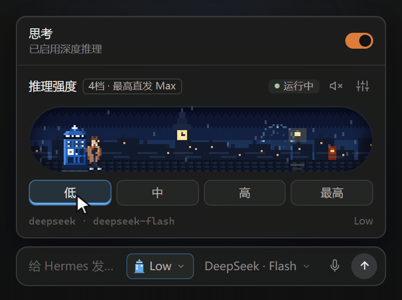

# TARDIS Thinking Effort · Hermes Desktop Plugin

[English](#english) | [简体中文](#简体中文)



---

## English

Standalone runtime plugin for **Hermes Desktop** that replaces the default thinking-effort dropdown in the chat composer with an interactive **16-bit *Doctor Who* TARDIS pixel-art capsule slider**.

### Features

- **4-Stage Pixel Scenes**:
  - **Low**: Rainy London street with the 10th Doctor leaning beside the glowing TARDIS
  - **Medium**: Low-Earth orbit hover above the sunlit planet
  - **High**: Deep-space cruise with a 90° rigid rotation leap
  - **Max**: 10th Doctor blue-and-orange Time Vortex with lightning & pixel afterimages
- **Directional Cinema Transitions & Auto-Sleep**: Stepping down plays return-to-orbit / cut / London rematerialization animations instead of rewinding frames, and automatically sleeps after 2s idle for zero background CPU usage.
- **Model-Aware Tier Mapping**:
  - **DeepSeek / Nous Portal / GLM-5.3 / GPT-5.6 / Default**: `low / medium / high / max`
  - **Gemini 4 / Kimi K2 / TokenHub / Nebius / Upstage / Legacy Grok**: `low / medium / high`
  - **Kimi K3**: `low / high / max`
  - **GLM-5.2**: `high / max`
  - **Grok 4.6+ / Codex**: Dispatches `xhigh` / `max` / `ultra` directly when supported by the model
- **Live Gateway Sync**: Keeps **Thinking**, **Fast / Ultra**, and **Daybreak** toggles (shown when supported by account & model) synced with active sessions and new chat defaults.
- **Upgrade-Safe**: Runs as an external desktop plugin without touching Hermes source code, surviving `hermes update`.

### Installation

#### Method 1: Install via GitHub inside Hermes Desktop (Easiest)

Open Hermes Desktop → **Capabilities → Plugins** and install from Git:

```text
JOJO1999-tpi/tardis-effort-kit
```

Or paste the full URL: `https://github.com/JOJO1999-tpi/tardis-effort-kit`.

#### Method 2: One-Click Install from Release Zip

Download `hermes-tardis-effort-plugin.zip` from [Releases](https://github.com/JOJO1999-tpi/tardis-effort-kit/releases), extract it, and run:
- **Windows**: Double-click `install-windows.bat`
- **macOS / Linux**: `bash install-unix.sh`

#### Method 3: Manual Copy

Copy [`plugin.js`](plugin.js) (from `desktop/plugin.js` in this repo, or `plugin.js` from the Release archive) into `<HERMES_HOME>/desktop-plugins/tardis-effort/plugin.js`:
- **Windows default**: `%LOCALAPPDATA%\hermes\desktop-plugins\tardis-effort\plugin.js`
- **macOS / Linux default**: `~/.hermes/desktop-plugins/tardis-effort/plugin.js`

### Configuration & Reload

1. Hermes Desktop watches `desktop-plugins/` automatically (or press **`Ctrl+K` / `Cmd+K`** and run **`Reload desktop plugins`**).
2. Open **Settings → Plugins → TARDIS 推理强度** for live preview & preferences:
   - Hide native thinking-effort pill (enabled by default)
   - Hide model-list hover submenu (enabled by default; keeps stars & model click)
   - Mute Vworp synth sound by default (muted by default)
3. Disabling or deleting the plugin removes injected styles cleanly and restores Hermes's native UI immediately.

---

## 简体中文

将 **Hermes Desktop** 底部输入框的推理强度选择替换为 **16-bit《神秘博士》TARDIS 像素动画胶囊滑块** 的独立运行时插件。

### 核心特性

- **四阶段像素场景**：
  - `低`：伦敦雨夜街头 · 第 10 任博士倚靠 TARDIS
  - `中`：地球近地轨道 · 蓝星之上静谧悬浮
  - `高`：深空星海巡航 · 90° 刚体旋转跃进
  - `最高`：第 10 任博士风格蓝橙时间漩涡 · 闪电与残影特效
- **不倒带电影感转场 & 省电休眠**：向下调档会触发 TARDIS 返航入轨、闪切退出或雨夜伦敦物化 + 博士面向右侧走出的专属过场，静止 2 秒自动休眠零后台 CPU 占用。
- **按模型真实能力自适应**：
  - **DeepSeek / Nous Portal / GLM-5.3 / GPT-5.6 / 默认**：`低 / 中 / 高 / 最高 (max)`
  - **Gemini 4 / Kimi K2 / TokenHub / Nebius / Upstage / 旧 Grok**：`低 / 中 / 高`
  - **Kimi K3**：`低 / 高 / 最高`
  - **GLM-5.2**：`高 / 最高`
  - **Grok 4.6+ / Codex**：按模型实际支持直发 `xhigh` / `max` / `ultra`
- **完整网关同步**：顶部保留 **思考** 开关、**快速 / 极速模式** 与 **Daybreak**（仅在账号与模型支持时显示），切换直接同步实时会话或新对话默认值。
- **独立运行时插件，升级不丢**：无需改动或重编 Hermes 源码，执行 `hermes update` 后依然保留。

### 安装方式

#### 方式一：直接在 Hermes Desktop 通过 GitHub 安装（最简单）

在 Hermes Desktop 的 **Capabilities → Plugins** 中填入本仓库地址安装：

```text
JOJO1999-tpi/tardis-effort-kit
```

（或直接粘贴完整仓库链接：`https://github.com/JOJO1999-tpi/tardis-effort-kit`）

#### 方式二：下载 Release 压缩包一键安装

前往 [Releases](https://github.com/JOJO1999-tpi/tardis-effort-kit/releases) 下载 `hermes-tardis-effort-plugin.zip` 并解压：

- **Windows**：双击运行 `install-windows.bat`
- **macOS / Linux**：终端执行 `bash install-unix.sh`

#### 方式三：手动放入插件目录

将仓库 [`desktop/plugin.js`](plugin.js)（或压缩包中的 `plugin.js`）放到 `<HERMES_HOME>/desktop-plugins/tardis-effort/plugin.js`：

- **Windows 默认路径**：`%LOCALAPPDATA%\hermes\desktop-plugins\tardis-effort\plugin.js`
- **macOS / Linux 默认路径**：`~/.hermes/desktop-plugins/tardis-effort/plugin.js`

### 启用与设置

1. Hermes Desktop 正在运行时会自动扫描 `desktop-plugins/`（或按 **`Ctrl+K` / `Cmd+K`** 运行 **`Reload desktop plugins`**）。
2. 前往 **设置 → 插件 → TARDIS 推理强度** 可进行交互预览及调整选项：
   - **隐藏原生推理强度按钮**（默认开启）
   - **隐藏模型列表悬停子菜单**（默认开启，保留星标收藏与点击切换模型）
   - **默认静音 (Vworp 音效)**（默认静音）
3. 停用或删除本插件后会自动清理注入样式，立即还原 Hermes 原生界面。
